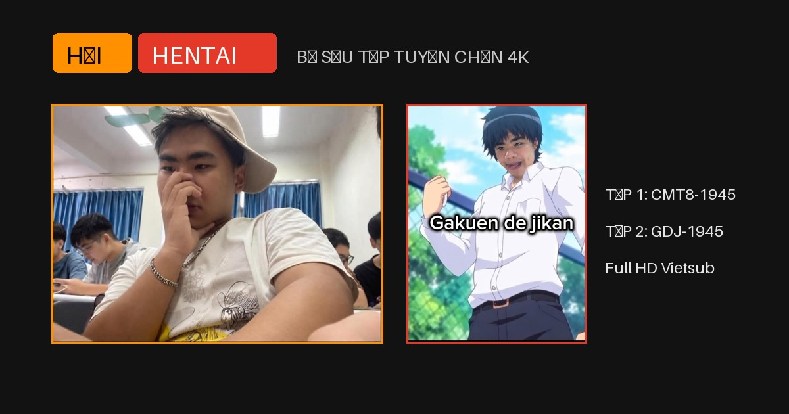

# 🔥 Album Hải Hentai (Official) - HAI.EXE

Trang web bộ sưu tập meme và album ảnh Hải Hentai chuyên nghiệp, tương thích 100% trên điện thoại di động và máy tính, hỗ trợ chia sẻ liên kết xem trước (Open Graph preview card) trên Facebook, Zalo, Messenger, Discord, Telegram.

## 🌟 Tính năng nổi bật

- **📱 Tối ưu hóa 100% cho điện thoại di động (Mobile Responsive):**
  - Tự động co giãn theo kích thước màn hình, hiển thị trọn vẹn cả ảnh ngang (`4K`) và ảnh dọc (`Gakuen de jikan`).
  - Hỗ trợ vuốt chạm cảm ứng (Touch Swipe): Vuốt trái để sang tập tiếp, vuốt phải để về tập trước.
  - Hàng phím tập `#1`, `#2` và cụm 4 chỉ số (Like, Dislike, Tim, Views) được bố trí thành lưới linh hoạt trên màn hình điện thoại.
- **🖼️ Xem trước khi chia sẻ link (Open Graph / Social Card Review):**
  - Tích hợp đầy đủ thẻ meta `og:image`, `og:title`, `og:description` với banner 1200x630 chuẩn Facebook, Zalo, Discord, Twitter.
  - Khi dán link `https://pvm-05.github.io/hai_hentai/` (hoặc `https://pvm-05.github.io/HAI.EXE/`), mạng xã hội sẽ tự động hiển thị thẻ preview hình ảnh bắt mắt.
- **✨ Trải nghiệm trang web thực thụ:**
  - Biểu tượng trang web (Favicon) chuẩn HD.
  - Hệ thống tab nội dung: Thư viện album, Bình luận tương tác (có thể gửi bình luận trực tiếp), Thông tin tác phẩm.
  - Phóng to ảnh toàn màn hình (Lightbox) khi nhấp chuột hoặc chạm vào ảnh.
  - Nút chia sẻ nhanh tích hợp Web Share API cho thiết bị di động.

## 🚀 Triển khai trên GitHub Pages

1. Vào repository: **`https://github.com/PVM-05/HAI.EXE`**
2. Vào **Settings** ➔ **Pages** (cột trái).
3. Tại **Build and deployment**, chọn **Source**: **GitHub Actions** (đã cấu hình sẵn) hoặc **Deploy from a branch** (nhánh `main`, thư mục `/ (root)`).
4. Trang web sẽ trực tuyến tại:
   - `https://pvm-05.github.io/hai_hentai/` (nếu đổi tên repo thành `hai_hentai`)
   - Hoặc `https://pvm-05.github.io/HAI.EXE/` (theo tên repo hiện tại).
